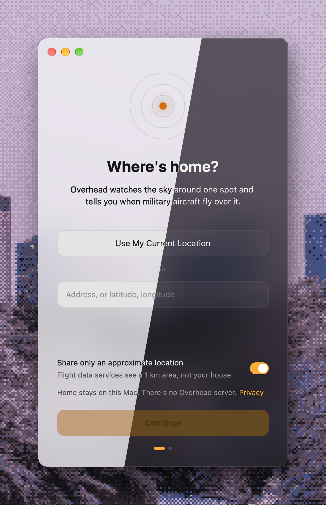

# Overhead

A small Mac app that tells you when military aircraft fly over your home.

<p align="center">
  
  
  
</p>

Overhead checks public ADS-B data every 10 seconds. When a military aircraft enters the area around home, you get a notification showing its type, callsign, distance and altitude. The window lists what's overhead now and what flew past recently, with a link to each aircraft on Flightradar24.

- Set home with your current location, an address, or coordinates.
- Click the radius in "Within 10 mi of home" to change it (1–250 miles).
- Click **home**, or choose **Overhead → Change Home Location…**, to move home.
- Open **Settings** with the ⚙ button or ⌘, to change home, the radius and approximate location, or to only watch a range of altitudes.
- Close the window and Overhead keeps watching and notifying from the Dock. Click the Dock icon to bring it back, or press ⌘Q to stop.

## Install

1. Download `Overhead-<version>.dmg` from [Releases](https://github.com/y-u-s-u-f/overhead/releases/latest).
2. Open it and drag Overhead into Applications.
3. Open Overhead. It isn't notarized by Apple, so the first time macOS will refuse to open it. Go to **System Settings → Privacy & Security**, scroll down, and click **Open Anyway**.

   Or run this once in Terminal:

   ```sh
   xattr -dr com.apple.quarantine /Applications/Overhead.app
   ```

You need macOS 13 or later on an Apple silicon Mac.

## Build from source

You need Rust and the Xcode Command Line Tools.

```sh
cargo run                      # run from source
./scripts/bundle.sh --install  # build Overhead.app and copy it to /Applications
./scripts/dmg.sh               # build target/Overhead-<version>.dmg
```

## How it works

- **Data:** [adsb.fi](https://adsb.fi), with [adsb.lol](https://adsb.lol) as a fallback when adsb.fi doesn't respond. Aircraft are marked military by the feeds' own database (`dbFlags`).
- **Address lookup:** [OpenStreetMap Nominatim](https://nominatim.org).
- **Your location:** Core Location, used once if you choose it during setup.

There's no Overhead server. Home is saved only on your Mac, and by default the flight data services get it rounded to about 1 km. See [PRIVACY.md](PRIVACY.md) for details.

## Credits

Sounds are from Google's [Material Design sound resources](https://m2.material.io/design/sound/sound-resources.html), licensed under [CC BY 4.0](https://creativecommons.org/licenses/by/4.0/).

## License

MIT. See [LICENSE](LICENSE). The sounds keep their own CC BY 4.0 license.
