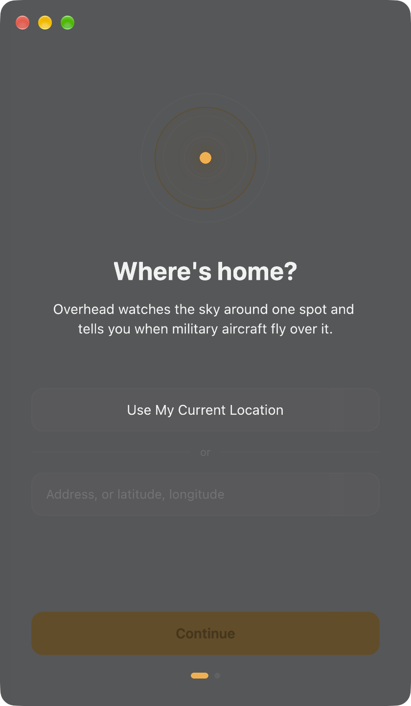
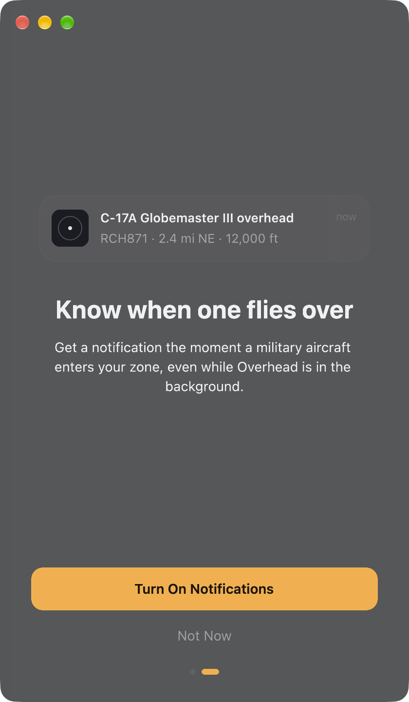
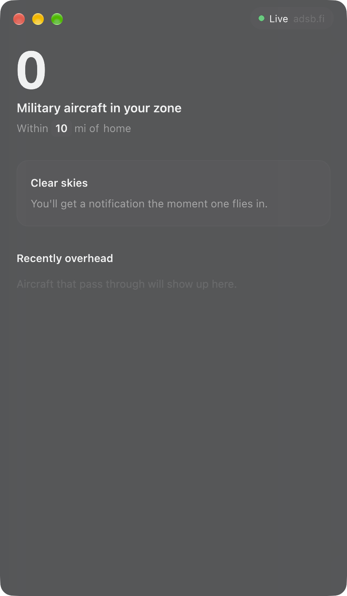

# Overhead

A small Mac app that tells you when military aircraft fly over your home.

<p>
  
  
  
</p>

Overhead checks public ADS-B data every 10 seconds. When a military aircraft enters the area around home, you get a notification showing its type, callsign, distance and altitude. The window lists what's overhead now and what flew past recently, with a link to each aircraft on Flightradar24.

- Set home with your current location, an address, or coordinates.
- Click the radius in "Within 10 mi of home" to change it (1–250 miles).
- Click **home**, or choose **Overhead → Change Home Location…**, to move home.

## Install

1. Download `Overhead-<version>.dmg` from [Releases](https://github.com/y-u-s-u-f/overhead/releases/latest).
2. Open it and drag Overhead into Applications.
3. Open Overhead. It isn't notarized by Apple, so the first time macOS will refuse to open it. Go to **System Settings → Privacy & Security**, scroll down, and click **Open Anyway**.

   Or run this once in Terminal:

   ```sh
   xattr -dr com.apple.quarantine /Applications/Overhead.app
   ```

You need macOS 13 or later on an Apple silicon Mac.

## Build from source

You need Rust and the Xcode Command Line Tools.

```sh
cargo run                      # run from source
./scripts/bundle.sh --install  # build Overhead.app and copy it to /Applications
./scripts/dmg.sh               # build target/Overhead-<version>.dmg
```

## How it works

- **Data:** [adsb.fi](https://adsb.fi), with [adsb.lol](https://adsb.lol) as a fallback when adsb.fi doesn't respond. Aircraft are marked military by the feeds' own database (`dbFlags`).
- **Address lookup:** [OpenStreetMap Nominatim](https://nominatim.org).
- **Your location:** Core Location, used once when you choose it during setup. Home is stored only on your Mac, in `~/Library/Application Support/Overhead`.

## Credits

Sounds are from Google's [Material Design sound resources](https://m2.material.io/design/sound/sound-resources.html), licensed under [CC BY 4.0](https://creativecommons.org/licenses/by/4.0/).
